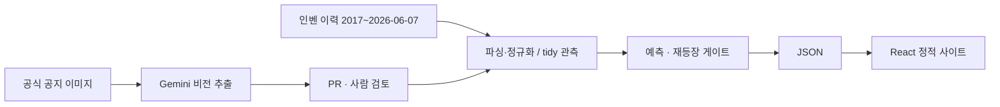

# 썬데이 메이플 예보

역대 보상 기록으로 다음 썬데이 메이플의 후보를 예측하고, 결과를 기록하는 비공식 팬 프로젝트입니다.

**[사이트 바로가기](https://seah1006.github.io/sunday-maple/)** · [방법론](https://seah1006.github.io/sunday-maple/#/about) · [분석 요약](https://seah1006.github.io/sunday-maple/#/insights)

## 무엇을 하나요?

| 기능 | 내용 |
|---|---|
| 다음 회차 예측 | 게이트를 적용한 랜덤포레스트 후보 순위와 모델 점수, Prophet 비교 |
| 적중 기록 | 과거 데이터 백테스트와 일요일 전에 저장한 실전 예측을 구분 |
| 역대 이력 | 보상 검색·카테고리 필터·보상별 등장 횟수와 주기 |

모델 점수는 보정된 확률이 아닙니다. 상위 후보는 검토 우선순위일 뿐 확정 예보가 아닙니다.

## 데이터 파이프라인

인벤의 약 9년 이력(2017-03-12~2026-06-07)에 공식 공지 이미지의 보상을 연결합니다. 이미지 추출 결과는 바로 사용하지 않고 PR에서 검토한 뒤 승인된 행만 운영 예보에 반영합니다.



| 구분 | 기준 |
|---|---|
| 운영 예보 | 승인된 전체 관측으로 매주 재학습, 180일 재등장 게이트 적용 |
| 과거 백테스트 | 2025-01-01 이전 학습, 이후 회차 평가로 고정 |
| 갱신 | 월요일 10:00 KST 수집 PR → Aside 루틴 검토 → 사용자 승인 후 머지 → 예보·사이트 갱신 |
| 저장 | 원본·관측 CSV·사이트 JSON. API 서버나 DB 없이 GitHub Pages로 제공 |

PR 브랜치에서 이미지를 대조하고 미등록·오인식 행을 고친 뒤 승인합니다. 자동 머지는 하지 않습니다.

```powershell
py -m src.weekly approve --notice-ids 1405 --review-method image_checked
```

## 숫자로 보는 결과

| 항목 | 값 | 기준 |
|---|---:|---|
| tidy 데이터 | 1,160행 · 14컬럼 | 인벤 원본, 빈 회차 포함 |
| 분석 대상 | 1,118행 | 보상이 있고 미래가 아닌 행 |
| 정규화 보상 | 기존 48종 + 신규 1종 = 49종 | 신규: 룬 기본 지속시간 증가 |
| 공식 이미지 추출 검증 | 12/12 완전 일치 | scope_v3, 정규화된 보상 집합 기준 |
| 승인 백필과 추출 결과 비교 | 20/20 완전 일치 | scope_v3, scope와 정규화 보상 집합 기준 |

| 백테스트 방법 | date_hit_rate |
|---|---:|
| 간격규칙 | 0.348 |
| 사전확률 | 0.362 |
| 로지스틱 | 0.391 |
| 랜덤포레스트 | 0.449 |
| **랜덤포레스트(게이트)** | **0.522** |
| Prophet | 0.420 |

`date_hit_rate`는 후보 안의 실제 보상 수 k만큼 상위 k개를 골랐을 때 하나라도 맞힌 회차의 비율입니다. 이 표는 고정된 시간 분할 백테스트이며, 매주 전체 관측으로 재학습하는 운영 모델의 실전 성적은 아닙니다.

근거: [`data/site/backtest.json`](data/site/backtest.json), [`rewards.json`](data/site/rewards.json), [추출 평가표](docs/extraction_eval.md), [기존 분석 리포트](outputs/report/final_report.md). 리포트의 6월 개별 예보 점수는 당시 실행 환경의 기록이며 현재 운영 예보와 다릅니다.

## 설계 판단

| 판단 | 이유 |
|---|---|
| raw와 예측 스냅샷 불변 | 원본·당시 예측을 나중에 덮어써 결과가 달라지는 일을 막음 |
| 시간 분할 백테스트 | 미래 관측이 학습에 섞이지 않도록 평가 경계를 고정 |
| 180일 재등장 게이트 | 오래 나오지 않은 보상을 경과일만으로 상위에 올리는 문제 완화 |
| 월드 전용 scope 분리 | 전용 혜택을 일반 회차 기록과 섞지 않음. 모델은 `scope=all`만 사용 |
| 자동 머지 없는 사람 검토 | 이미지 오인식·미등록 보상을 확인하고 승인 근거를 기록 |

단종은 영구적인 사실로 단정하지 않습니다. 실제 재등장이 확인된 `스타포스_1+1강화`는 운영 경로의 단종 목록에서 제거했고, 과거 백테스트 경로는 비교를 위해 유지했습니다.

## 실전 기록

첫 스냅샷의 대상일은 **2026-11-01**이며, 저장 시각은 **2026-10-24 14:25 KST**입니다. 일요일 전에 전체 후보 순위를 저장하고 한 번 쓴 파일은 수정하지 않습니다. 승인된 실제 보상과 대조해 상위 5개 적중 수·k-적중·후보 밖 보상을 기록합니다.

이 스냅샷은 코드 커밋 전에 만들어져 `model_version=695c614`, `working_tree_dirty=true`로 남아 있습니다. 당시 구현의 코드 기준은 **Phase 24 커밋 [`8f47363`](https://github.com/seah1006/sunday-maple/commit/8f47363)**입니다. 스냅샷을 고쳐 이 차이를 숨기지 않습니다.

## 로컬 실행

Python은 이 프로젝트 환경의 `py` 런처를 사용합니다. Node.js 24와 npm이 필요합니다.

```powershell
py -m pip install -r requirements.txt
py -m src.site_data
cd web
npm ci
npm run dev
```

로컬 사이트 경로도 `/sunday-maple/`입니다. `site_data` 실행은 JSON을 다시 만듭니다. 불변 예측 스냅샷은 `py -m src.weekly forecast`가 별도로 저장합니다.

```powershell
py -m pytest -q -p no:cacheprovider
cd web
npm run lint
npm run test -- --run
npm run build
```

## 출처·고지

- [인벤 역대 썬데이메이플 정리](https://www.inven.co.kr/board/maple/2304/20563)
- [메이플스토리 공식 이벤트 공지](https://maplestory.nexon.com/News/Event)
- **넥슨과 무관한 비공식 프로젝트**입니다. 공지 이미지와 게임 관련 자료의 권리는 각 권리자에게 있습니다.

## 개발 방식

Claude는 조사·계획·리뷰를, Codex는 구현·테스트를 담당합니다. 단계별 사양과 인계 기록은 [`docs/`](docs/)의 Work Packet과 handoff에 남깁니다. 배포·원격 설정·머지는 사용자 승인 아래 진행합니다.
