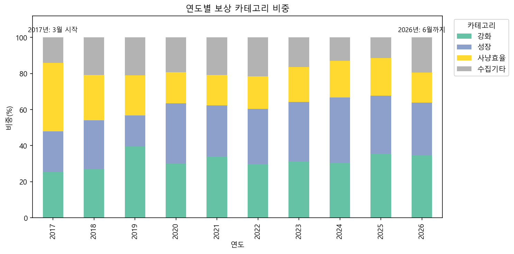
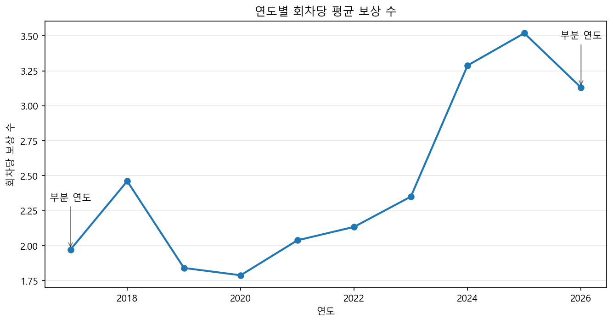
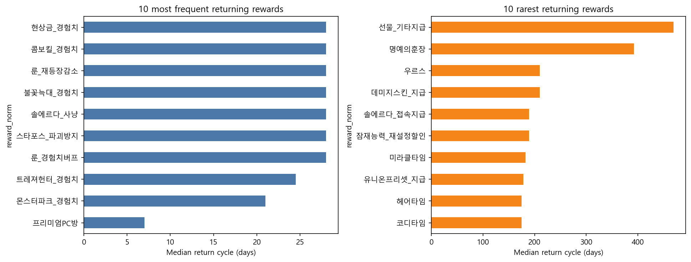
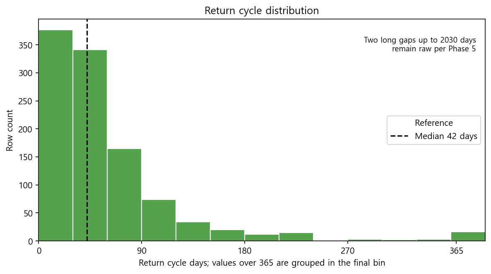
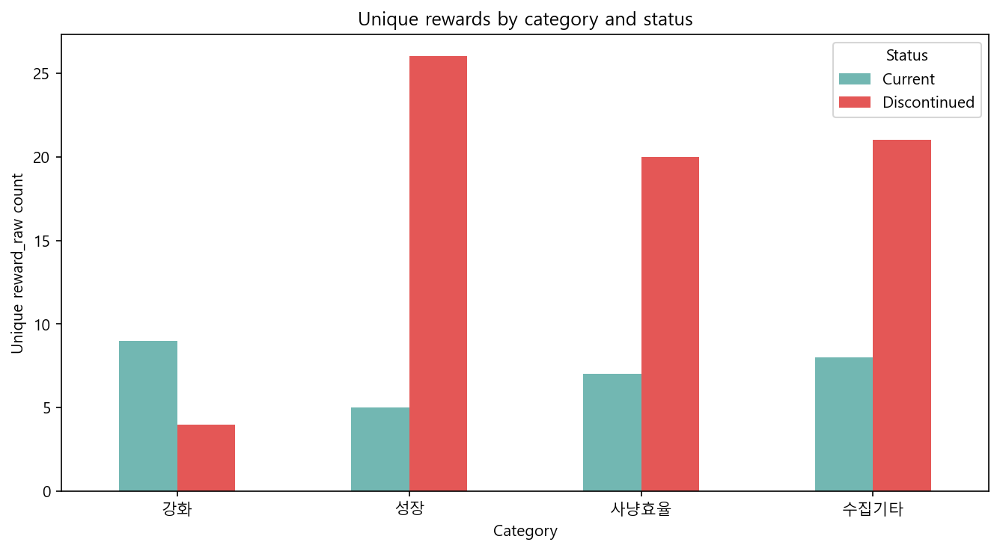
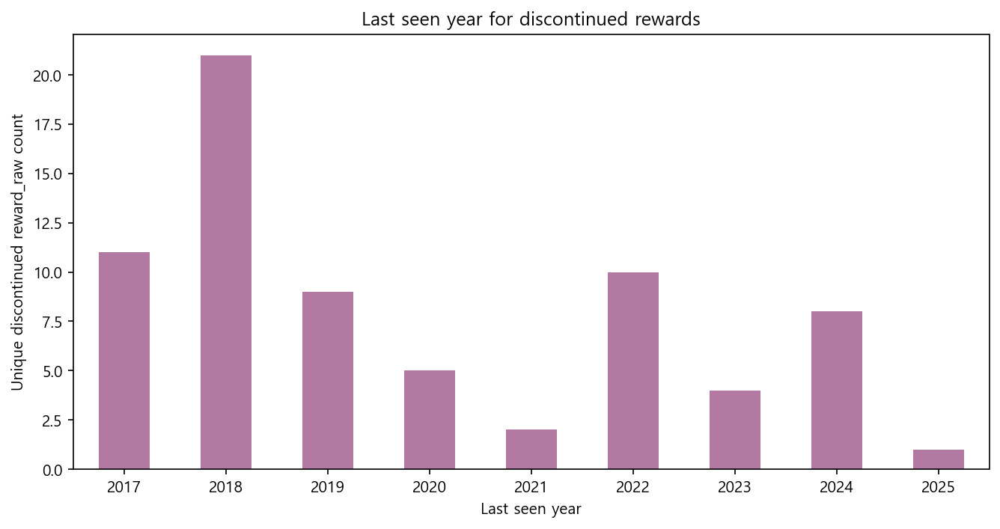
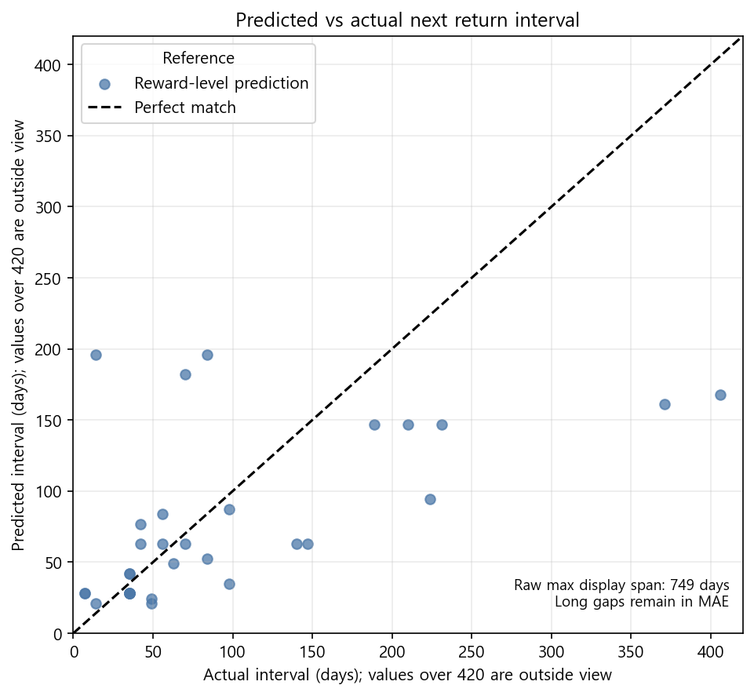

# 선데이메이플 정규 보상 패턴 분석 최종 리포트

## 1. 프로젝트 개요와 데이터 출처

이 프로젝트는 2017년 3월부터 2026년 6월까지 약 9년간의 선데이메이플 정규 보상 기록을 한곳에 정형화하고, 그 안에서 보상 구성과 운영 방식이 어떻게 달라졌는지를 읽어내는 것을 목표로 한다. 분석 대상 기간은 2017-03-12부터 2026-06-07까지이며, 원본은 인벤 게시글 한 곳에서 추출한 2차 자료다. `data/raw/`에 보관한 이 원본은 분석 내내 읽기 전용으로만 다뤄 한 번도 수정하지 않았다.

관측 단위는 "특정 날짜에 등장한 하나의 원문 보상"으로 잡았다. 그래서 데이터의 유일성 기준은 `(date, reward_raw)`이고, `reward_norm`은 표현이 조금씩 다른 원문 보상들을 같은 분석 라벨로 묶기 위한 보조 값으로 둔다. 이렇게 만든 최종 tidy 데이터는 1160행 14컬럼이며, 아직 공개되지 않은 미래 회차 블록과 보상이 아예 없던 주차까지 포함한다. 실제 분석에는 이 가운데 `reward_norm`이 있고 미래 회차가 아닌 1118행을 사용했다.

## 2. 데이터 파이프라인

파이프라인은 수집, 파싱·정제, 교차검증, 탐색적 분석, 보조 모델링의 다섯 단계로 분리했다. `01_collect.ipynb`가 원본 HTML과 원시 텍스트를 모으고, `02_parse_clean.ipynb`가 날짜별·종류별 두 뷰를 파싱해 `data/processed/tidy_rewards.csv`로 정리한다. 이어 `03_crossval.ipynb`가 두 뷰의 보상 빈도와 단종 속성을 맞대어 검증하고, `04_eda.ipynb`와 `05_model.ipynb`가 분석 그림 7개를 만든다. 각 단계는 중간 산출물을 파일로 넘기므로, 커널을 새로 시작해도 노트북을 순서대로 실행하면 같은 결과가 재현된다.

최종 tidy 스키마는 `date`, `reward_raw`, `reward_trailing`, `reward_norm`, `category`, `reward_magnitude`, `event_context`, `is_major_event`, `is_special`, `time_limited`, `is_discontinued`, `is_future`, `no_event_week`, `cycle_days`의 14컬럼이다.

전처리에서 특히 판단이 갈렸던 결정은 네 가지다. 첫째, 관측 단위를 `reward_raw`로 확정하고 `(date, reward_norm)` 중복은 같은 날 동반 지급된 별개 보상으로 보아 제거하지 않았다. 둘째, 환생의 불꽃이나 솔 에르다처럼 성격이 다른 보상은 갈라서 정규화하고, 샤이닝 스타포스 타임 같은 별칭은 대표 보상 라벨로 통합했다. 셋째, 보상이 아직 공개되지 않은 미래 빈 블록 12행은 지우지 않고 `is_future=True`로 남겨 두었다. 넷째, `2024.04.01(월) (유니온 릴레이)`처럼 날짜 헤더에 요일이 붙은 경우 요일은 이벤트명이 아니므로 떼어 내고 `event_context`만 살렸다.

## 3. 데이터 신뢰성 검증

원본이 2차 자료인 만큼, 공식 공지와 직접 대조해 믿을 만한지부터 확인했다. 스팟체크는 세 회차를 대상으로 했다. 2026-04-19는 공식 보상 3개가 tidy와 3/3으로 모두 맞았고, 2025-07-27도 4개가 4/4로 일치했다. 2023-05-21은 공식 보상 5개 중 정규 보상 3개가 tidy와 그대로 맞았고, 나머지 이벤트 연동 보상 2개는 인벤 원본 자체에 실리지 않아 빠진 것으로 확인됐다.

원본 안에서도 종류별 뷰와 날짜별 뷰를 교차검증했다. 동일 `reward_raw` 등장 횟수를 기준으로 한 일치율은 0.726으로, 단일 2차 출처라는 한계 안에서 두 독립 뷰가 대체로 같은 이야기를 하고 있음을 보여 준다.

일요일이 아닌 행은 모두 11개다. 2023-01-12부터 2023-01-18까지 이어진 파워업 위크의 일별 보상 7행과, 2024-04-01 유니온 릴레이 4행이 여기 해당한다. 둘 다 원문 형식에 근거가 있어 예외로 그대로 유지했다.

## 4. 탐색적 분석

### Q1. 보상 카테고리 구성은 어떻게 변했나?

분석 대상 1118행을 카테고리별로 나누면 강화 357행, 성장 337행, 사냥효율 234행, 수집기타 190행이다. 연도별 비중을 따라가 보면 흐름이 분명하다. 2017년에는 사냥효율이 38.0%로 가장 큰 축이었지만, 시간이 지나면서 강화와 성장 쪽으로 무게가 옮겨 간다. 다만 2017년은 3월부터, 2026년은 6월까지만 집계된 부분 연도이므로 양 끝 해는 비중 해석에 주의가 필요하다.

### Q8. 한 회차에 주는 보상 수는 늘었나?

회차당 보상 수는 꾸준히 늘었다. 2017년 1.972개에서 2025년 3.519개까지 올라왔고, 2024년 3.288개, 6월까지인 2026년도 3.130개로 높은 수준을 이어 간다. 한 번에 단일 혜택을 주던 초기 방식에서, 여러 보상을 한꺼번에 묶어 제시하는 운영으로 옮겨 갔다고 읽을 수 있다.

### Q2. 보상마다 다시 등장하는 주기는 얼마나 다른가?

`cycle_days`를 계산할 수 있는 관측치는 1063행이고, 중앙값은 42일, 평균은 65.2일이다. 가장 자주 돌아오는 보상은 프리미엄PC방으로 중앙 7.0일이며, 몬스터파크_경험치 21.0일, 트레져헌터_경험치 24.5일이 뒤를 잇는다. 룬_경험치버프, 스타포스_파괴방지, 솔에르다_사냥, 불꽃늑대_경험치, 룬_재등장감소, 콤보킬_경험치, 현상금_경험치는 나란히 28.0일 주기로 묶인다. 이들이 선데이메이플을 떠받치는 주력 보상인 셈이다.

반대편 끝에는 좀처럼 보기 힘든 보상들이 있다. 선물_기타지급은 469.0일, 명예의훈장은 392.0일에 한 번 꼴이고, 데미지스킨_지급과 우르스가 각 210.0일, 잠재능력_재설정할인과 솔에르다_접속지급이 각 189.0일이다. 최대 주기는 2030일까지 벌어지는데, 1500일을 넘는 장기 미등장 2건은 단종 후 부활이나 장기 휴면의 실제 값으로 보고 Phase 5 결정대로 원값을 유지했다. 히스토그램에서는 365일을 넘는 14건을 마지막 구간에 한데 모아 표시했다.

### Q3. 무엇이 사라지고 무엇이 살아남았나?

단종으로 표시된 관측치는 311행이고, 고유 `reward_raw` 기준으로는 71개 보상이 단종됐다. 카테고리별 고유 보상 수를 현행과 단종으로 나눠 보면 차이가 뚜렷하다. 강화는 현행 9개에 단종 4개로 살아남은 쪽이 많지만, 성장은 현행 5개·단종 26개, 사냥효율은 현행 7개·단종 20개, 수집기타는 현행 8개·단종 21개로 단종 비중이 훨씬 크다. 성장·사냥효율·수집기타 계열에서 보상 정리가 집중적으로 일어났다는 뜻이다.

단종 보상이 마지막으로 등장한 연도를 보면 2017년 11개, 2018년 21개, 2019년 9개, 2020년 5개, 2021년 2개, 2022년 10개, 2023년 4개, 2024년 8개, 2025년 1개로, 2018년에 정리가 가장 크게 몰렸다. 다만 2024~2025년에 마지막으로 등장한 9개는 수집 시점 탓에 아직 단종 여부가 뒤집힐 수 있어 함께 감안해야 한다. 여기서 '단종'은 원문 작성자가 붙인 `(단종)` 표기를 그대로 따른 값이라는 점도 밝혀 둔다.

## 5. 보조 베이스라인 모델

보조 모델은 정확도를 겨루기 위한 것이 아니라, 각 보상의 다음 등장 간격을 과거 주기 중앙값으로 어림하는 최소 기준선을 세워 보기 위한 것이다. 평가 대상은 등장이 3회 이상인 `reward_norm` 34개이며, 전역 `cycle_days` 중앙값은 42.0일이다.

보상별 과거 중앙값으로 예측했을 때 평균절대오차는 74.49일, 모든 보상에 전역 중앙값을 똑같이 적용한 경우는 93.65일이었다. 보상마다 자신의 과거 주기만 참고해도 전역 기준보다 오차가 작다는 점은 확인됐지만, 이 단순한 모델은 장기 미등장이나 운영 정책 변화까지 설명하지는 못한다. 실제값이 420일을 넘는 2건은 산점도 표시 범위 밖으로 빠지지만, MAE 계산에는 원값 그대로 반영했다.

## 6. 한계와 스코프

원본이 단일 2차 출처인 만큼 공식 공지 전체를 그대로 대신하지는 못한다. 스팟체크에서 정규 보상은 공식과 일치했지만, 이벤트 연동 일회성 보상은 인벤 원본에 실리지 않는 경우가 있었다. 따라서 이 리포트가 다루는 범위는 어디까지나 '정규 선데이메이플 보상'의 패턴이다.

`time_limited`는 1140행이 결측이고 비결측이 20행뿐이라, 시간제와 하루종일을 가르는 분석 축으로 삼기에는 근거가 부족했다. 또 앞서 언급한, 2024~2025년에 마지막으로 등장한 단종 보상 9개는 수집 이후 다시 나올 여지가 있어 영구 단종으로 단정하지 않고 원문 표기 상태로만 해석한다.

## 7. 결론

선데이메이플 보상은 2017년 이후 한 회차에 담기는 보상 수가 꾸준히 늘었고, 최근으로 올수록 강화와 성장 계열이 큰 축을 이룬다. 재등장 주기의 중심은 42일이지만, 일부 보상은 수백 일 이상 벌어지고 장기 미등장 사례까지 존재할 만큼 편차가 크다.

단종 쪽에서는 성장·사냥효율·수집기타 카테고리에 정리된 보상이 몰렸고, 마지막 등장 시점은 2018년에 가장 집중됐다. 단, 단종은 원문 표기를 따른 상태값이라 최근 연도의 표기는 데이터가 더 쌓이면 달라질 수 있다. 종합하면 이 데이터는 정규 보상의 운영 강도가 세지는 흐름과, 보상 포트폴리오가 재편되어 온 과정을 함께 보여 준다.
